<div align="center">



[← Back to Ronald Rex's engineering portfolio](https://github.com/RONALD-REX-7)

</div>

---

# QUARTZSENTRY — Academic Software Demonstrator (Thermal Runaway Simulation)

[](https://github.com/RONALD-REX-7/QUARTZSENTRY/actions/workflows/ci.yml)
[](https://vitejs.dev/)
[](https://react.dev/)
[](https://www.typescriptlang.org/)
[](https://oxc.rs/)
[](https://www.w3.org/WAI/standards-guidelines/wcag/)
[](https://github.com/RONALD-REX-7/QUARTZSENTRY)
[](LICENSE)

> **Academic Engineering Prototype & Software Demonstrator**  
> **Team:** METRYPHOR  
> **Institution:** S.A. Engineering College (Autonomous), Chennai, Tamil Nadu, India  
> **Live Demonstrator**: [https://quartzsentry-prototype.vercel.app](https://quartzsentry-prototype.vercel.app)

---

> [!CAUTION]
> **Academic Software Demonstrator Notice**:
> - QUARTZSENTRY is a student engineering proof-of-concept and web demonstrator developed for academic competition and research exploration.
> - **All telemetry, Nyquist impedance curves, acoustic RMS values, and gas ppm readings displayed in this web dashboard are synthetic signals deterministically modeled in-memory** (`src/simulation.ts`).
> - The physical sensor transducers, analog front-ends (AFE), and physical microcontroller hardware integration are **incomplete** and tracked under active backlog issues (e.g., [Issue #2](https://github.com/RONALD-REX-7/QUARTZSENTRY/issues/2)).
> - This software is **NOT** a certified commercial safety system (no ISO 26262 ASIL, UL 9540A, or UNECE R100/AIS-156 certification) and must **never** be deployed as an autonomous battery safety intervention without certified physical BMS hardware interlocks.

---

## 1. Executive Summary & Purpose

Lithium-ion battery thermal runaway (TR) represents a critical safety risk in electric mobility and stationary grid storage. Traditional battery management systems (BMS) rely primarily on bulk temperature and voltage monitoring, which frequently register abnormalities only after irreversible internal exothermic reactions, venting, or cell rupture have initiated.

**QUARTZSENTRY** serves as an academic software demonstrator simulating multimodal early-precursor detection across four progressive risk states:
1. **Dynamic Electrochemical Impedance Spectroscopy (GD-EIS):** Simulates low-frequency Warburg impedance and charge transfer resistance ($R_{ct}$) drift indicative of micro-dendrite growth.
2. **Ultrasonic / Acoustic Emission (AE):** Simulates structural acoustic energy release from micro-delamination and internal gas cavitation.
3. **Off-Gas Detection:** Simulates hydrogen ($H_2$) and volatile organic compound (VOC) vapor release preceding cell venting.
4. **Thermodynamic Surface Telemetry:** Simulates cell-level gradient monitoring across a 16-cell series Li-ion module.

---

## 2. Evidence & Architectural Reality Matrix

In accordance with strict engineering integrity standards, the table below documents the boundary between software-implemented features and planned physical hardware:

| Subsystem / Capability | Demonstrator Implementation | Physical Hardware Reality | Verification Status |
| :--- | :--- | :--- | :---: |
| **16-Cell Battery Telemetry** | Deterministic simulation in `src/simulation.ts` with cell-level voltage and temperature drift. | No physical 16-cell battery pack; telemetry is modeled in software. | **Stage 2: Implemented in Software** |
| **EIS Nyquist Visualization** | Real-time SVG Nyquist plotting of simulated Warburg impedance and charge-transfer resistance $R_{ct}$. | No physical potentiostat or high-frequency AFE hardware connected. | **Stage 2: Implemented in Software** |
| **Off-Gas Sensing ($H_2$, VOCs)** | Simulated threshold breach triggering advisory/warning states. | No physical metal-oxide or catalytic gas sensors connected. | **Stage 2: Implemented in Software** |
| **Acoustic Emission Analysis** | Simulated acoustic RMS signal modeling mechanical delamination. | Physical ultrasonic transducer integration is incomplete ([Issue #2](https://github.com/RONALD-REX-7/QUARTZSENTRY/issues/2)). | **Stage 1: Planned / Research Backlog** |
| **Progressive Risk Mitigation** | 4-tier state machine (Normal $\to$ Advisory $\to$ Warning $\to$ Critical) with automated contactor isolation. | Software state engine only; no physical HV contactor relays actuated. | **Stage 2: Implemented in Software** |
| **User Interface & A11y** | React 19 + Tailwind CSS dashboard adhering to WCAG 2.1 AA standards. | Verified with 6.16:1 text contrast ratio and keyboard navigable controls. | **Stage 3: Software Tested** |

---

## 3. Technology Stack & Verification Gates

- **Framework**: [React 19.2](https://react.dev/) + [Vite 8.3](https://vitejs.dev/)
- **Language**: [TypeScript 6.0](https://www.typescriptlang.org/)
- **Linting**: [Oxlint](https://oxc.rs/) (High-performance Rust-based static linter)
- **Accessibility Standard**: [WCAG 2.1 AA](https://www.w3.org/WAI/standards-guidelines/wcag/) compliant color contrast (6.16:1 text contrast ratio)
- **Icons & Visualization**: [Lucide React](https://lucide.dev/) + Recharts SVG rendering
- **Continuous Integration**: GitHub Actions workflow validating type safety, oxlint rules, and production bundle generation

---

## 4. Local Development & Build Reproduction

### Prerequisites
- Node.js `>= 20.0.0` (Node 22 recommended)
- npm `>= 10.0.0`

### Commands

```bash
# 1. Install dependencies
npm ci

# 2. Run static analysis (Oxlint)
npm run lint

# 3. Compile TypeScript and build production bundle
npm run build

# 4. Launch local development server
npm run dev
```

---

## 5. Security & Maintenance

- **License**: Released under the **Apache License 2.0**. See [`LICENSE`](./LICENSE) for terms.
- **Security Policy**: See [`SECURITY.md`](./SECURITY.md) for vulnerability disclosure guidelines.
- **Contributing Guidelines**: See [`CONTRIBUTING.md`](./CONTRIBUTING.md) for branching and verification procedures.
